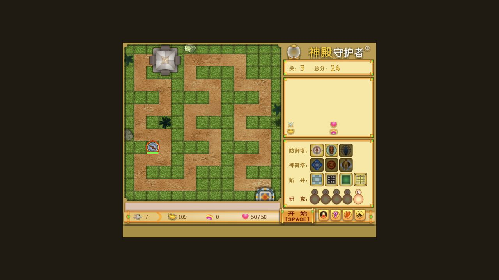

# 神殿守护者 · Temple Guardian

[在线游玩](https://xc1ym.github.io/temple-guardian/) · [逻辑复核](docs/logic-audit.md) · [开发说明](docs/development.md) · [来源与许可](NOTICE.md)

[](https://github.com/Xc1Ym/temple-guardian/actions/workflows/pages.yml)

《神殿守护者》原生 Web 移植。复用 2007 年原作的美术、音效、数值与游戏逻辑，让 Mac 和现代浏览器继续游玩这款 Flash 塔防游戏。

正式游戏使用 **TypeScript、PixiJS 8 和原生 JavaScript**，运行时不加载 SWF，也不需要 Flash、Ruffle 或 Windows。



## 游戏内容

- 原版 650×500 舞台、菜单、鼠标操作和快捷键；逻辑按 28 Hz 固定步长运行。
- 10 张内置地图、三种玩法、50 关、初章与终章。
- 原版设施建造、升级、出售、研究、敌人特殊能力、弹道、陷阱与计分规则。
- 原版剧情、说明、声音设置、地图编辑器和五个自编地图存档槽。
- 动态中文使用随网站提供的 Noto Sans CJK SC，修复原 SWF 依赖缺失宋体字形的问题；字体加载失败可重试。
- 设置、地图和成绩保存在当前浏览器。原版外部排行榜改为本机排行榜。

界面保持原版布局。此前新增的顶部工具条、属性卡和手机版专用交互已移除；窄窗口仅等比例缩放完整舞台。

## 操作

| 操作 | 按键／方式 |
| --- | --- |
| 建造、选择设施／敌人、升级、出售 | 鼠标及游戏内原版按钮 |
| 开始本关 | 空格或“开始 [SPACE]” |
| 暂停 | P；点击原版“返回游戏”继续 |
| 切换音效 | S |
| 追击／说明／退出 | A／H／Q |
| 打开修改器 | 鼠标移到页面顶部中央棕色区域（距顶部约 24～52 像素），隐藏按钮显现后点击；或直接输入英文 `godmode` |

第一关结束后，点击“下一关”，在原版窗口中选择玩法并确认。回合制进入下一关后仍需按空格开始出怪；第二关起普通过关窗口两秒后自动进入下一关的准备阶段。

设施升级在原版属性面板内进行，显示费用和前后属性；结果或资源不足原因写入原版提示栏。入口附近与部分神御设施的建造限制沿用原版。

研究加成会应用到已有／新建设施及设施升级，耐久制的消耗计数同步更新。原版提示栏显示研究等级及实际倍率；研究作用对象和原脚本遗留问题的修复见 [研究加成说明](docs/research-fix.md)。

首次交互后启用音频。切换到后台时自动暂停，返回后主动继续；准备倒计时随暂停冻结。清理浏览器数据会删除本机存档与成绩。

修改器默认关闭，入口平时不可见。可修改金钱、神迹、总分、神殿耐久及上限，开启资源锁定、无敌、免费交易、一击必杀、设施解锁、倒计时冻结，调整攻击、射程、攻击加速、敌人速度和游戏速度。另有研究满级、设施满级、恢复耐久、清除障碍、清关与跳关操作。打开面板时暂停，关闭恢复之前状态；退出本局后持续加持自动关闭。已修改的资源、研究和等级不会被“关闭全部加持”撤销。详细效果和数值范围见 [修改器说明](docs/trainer.md)。

## 本地启动

需要 **Node.js 24**：

```sh
git clone https://github.com/Xc1Ym/temple-guardian.git
cd temple-guardian
npm ci
npm run dev
```

打开终端显示的网址。macOS 也可双击 `start.command`。静态文件需要通过 HTTP 服务访问，不能直接双击 `index.html`。

构建及本地预览：

```sh
npm run build
npm run preview
```

## GitHub Pages 自动部署

网站地址：[xc1ym.github.io/temple-guardian](https://xc1ym.github.io/temple-guardian/)。

`.github/workflows/pages.yml` 在推送 `main` 时执行依赖安装、回归测试、素材／中文覆盖检查及生产构建，全部成功后部署到 GitHub Pages。Pull Request 只执行检查和构建；也可从 Actions 页面手动运行。

本仓库已启用 Pages。复制或 Fork 工程后，需要先在仓库的 **Settings → Pages → Build and deployment → Source** 中选择 **GitHub Actions**，再运行部署。工作流从 GitHub Pages 配置读取部署子路径，图片、字体、音频和游戏数据均使用对应路径。仓库改名或设置自定义域名后，重新运行部署即可；README 中的链接需同步修改。

本地验证项目子路径构建：

```sh
GAME_BASE_PATH=/temple-guardian/ npm run build
GAME_BASE_PATH=/temple-guardian/ npm run preview
```

发布目录为 `dist/`，仅包含正式网站所需代码和资源；原文件、参考播放器及源字体 OTF 不进入网站。字体、图片和音频由同一网站提供，游戏不使用 CDN。

## Docker 部署

```sh
docker compose up -d --build
```

默认端口为 `8080`。修改宿主端口及监听地址：

```sh
GAME_HTTP_PORT=8090 GAME_BIND_ADDRESS=0.0.0.0 docker compose up -d --build
```

容器监听 `8080`，使用非 root NGINX、只读文件系统和 `/healthz` 健康检查。支持 amd64／arm64；没有服务端数据库或存档卷。Docker 默认构建部署在域名根路径，HTTPS 反向代理示例见 [deploy/Caddyfile.example](deploy/Caddyfile.example)。

多架构镜像发布示例：

```sh
docker buildx build --platform linux/amd64,linux/arm64 \
  -t 你的镜像仓库/temple-guardian:1.0 --push .
```

## 还原与验证

原版 368 段 AS2 脚本转译为静态模块，保留时间轴、旋转中心、叠层和原始公式；原 SWF／EXE 和原始脚本校验值持续核对。

原始字节码参考对照已覆盖全部 26 个设施等级、50 关生成的 560 个敌人记录、840 帧固定实战的 243 个采样点，以及 18 类敌人的 33,750 个形状碰撞点。参考运行时为 Ruffle，具体控制条件、浮点容差和修复依据见 [逻辑复核报告](docs/logic-audit.md)。

```sh
npm test
npm run check:assets
npm run build
```

本轮逻辑复核不等同于人工逐一打通全部地图、玩法与关卡。独立 Safari／Chrome、所有概率分支与技能组合、全部动画的逐帧人工核对范围见 [验证记录](docs/verification.md)。

## 开发与来源

目录说明、完整素材重现和原版参考播放器见 [开发说明](docs/development.md)。`dist/`、`release/`、依赖及本机缓存不纳入 Git；源码、生成资源、原文件及复核证据保留，以便重现。

原作署名为寒筝／9mine。原作美术、音频及原始游戏内容归原作者和相关权利人所有；本项目没有已确认的官方关联。Noto 字体使用 SIL OFL 1.1，完整说明见 [NOTICE.md](NOTICE.md)。
